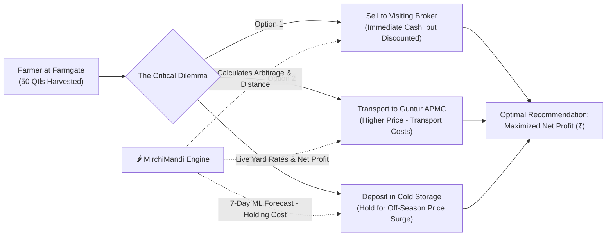

# 🌶️ MirchiMandi: Comprehensive Project & Feature Report

> **Real-Time Chilli Price Intelligence, Machine Learning Forecasting & Decision Support for Indian Farmers**

---

## 1. Executive Summary

**MirchiMandi** is a domain-specific AgriTech intelligence platform engineered for red chilli cultivators across Andhra Pradesh and Telangana (specifically centered around the **Guntur APMC Yard**, the largest chilli market in Asia).

The platform bridges the long-standing information and negotiation asymmetry between rural chilli farmers and intermediaries (commission brokers, traders, and cold storage operators) by transforming complex market data and machine learning forecasts into simple, actionable selling advice: **"Sell Today" vs. "Wait X Days"** and **"Sell to Local Broker" vs. "Transport to Mandi"**.


---

## 2. The Real-World Problem Identified

Chilli farming is one of the most capital-intensive, high-risk agricultural ventures in Southern India. Farmers invest ₹1.5 to ₹2.5 Lakhs per acre over a 5 to 6-month crop cycle involving intensive labor, pest management, and post-harvest sun curing. However, at harvest, farmers face three critical structural challenges:

### A. The Information Asymmetry Gap (The Farmgate Discount)
- **Broker Exploitation**: Middlemen and commission agents frequently visit villages (e.g., Pavulur, Inkollu, Chilakaluripet, Tenali) and exploit farmers' lack of live market visibility. Agents often claim that *"prices crashed at Guntur yard today"* and quote rates ₹1,500 to ₹3,500 below actual prevailing modal rates.
- **Financial Impact**: For a small-to-medium farmer selling 50 quintals, a ₹2,000/qtl gap represents a **direct, unrecoverable loss of ₹1,00,000** in a single afternoon.

### B. The Logistics & Distance Dilemma (Transport Arbitrage)
- Even when a farmer suspects a broker's price is low, transporting crop to Guntur APMC involves significant logistics costs:
  - Vehicle hire (Tractor: ₹1,500 base + ₹35/km; Tata Ace Trolley: ₹800 base + ₹25/km; Truck: ₹3,000 base + ₹45/km).
  - *Hamali* (unloading & loading labor: ₹40 per quintal).
- If the volume of harvest is small (e.g., 15–20 quintals) or the distance is substantial, transport expenses can wipe out the price difference, leaving the farmer worse off. Farmers previously had no tool to calculate this trade-off.

### C. The Cold Storage Holding Dilemma
- During harvest glut (February to May), prices often dip. Farmers must decide whether to sell immediately or rent space in commercial cold storages until the off-season (July to October).
- Cold storage and transport risk costs approximately **₹30 per quintal per day**.
- If the market price increases by only ₹100/qtl over 30 days, the farmer incurs a net loss after paying ₹900/qtl in storage and financing costs.

### D. Agmarknet Reporting Blindspots
- Official government portals (Agmarknet) record generic labels like *"Red"*, *"Red New"*, or *"White"*, while commercial trade operates on distinct cultivars: **Teja S17, 334 Sannam, Byadgi, 341, DD Deluxe, and Armoor**. Standard portals fail to capture these crucial variety-specific premiums.

---

## 3. What Problem MirchiMandi Solves



1. **Eliminates Market Blindness**: Provides verified daily price trends across all AP commercial varieties (Teja S17, 334 Sannam, 341, Byadgi, DD Deluxe, Armoor) with min, max, and modal averages.
2. **Quantifies Broker Exploitation in Rupees**: The Profit Calculator immediately displays: *"You are losing ₹45,000 by selling to the broker at ₹16,500 vs. Mandi ₹17,400"*.
3. **Calculates Exact Transport Feasibility**: Using rural AP pincodes and road distance coefficients, it calculates exact haulage and labor costs to tell the farmer whether going to the yard is profitable.
4. **Predicts the Trend with Storage-Cost Subtraction**: Rather than naive price prediction, the recommendation engine subtracts daily storage costs from ML forecasts to inform the farmer if waiting truly yields net profit.

---

## 4. Key Platform Features

### 1. 3D Animated Interactive Landing Page
- **Hero Canvas**: Built with Three.js, rendering realistic 3D Indian red chillies with natural sickle curvature, tapered fluting, green calyx/stem, organic PBR physical wax sheen, and ambient spice embers.
- **Interactive Mouse Parallax & 360° Drag**: Users can tilt and rotate the 3D chillies in real-time.
- **Bilingual Switcher**: Seamless instant toggle between English and Telugu (తెలుగు) across all headers, cards, and data metrics.
- **Harvest Showcase**: Features high-resolution imagery of harvested dry red chillies with authentic grading tags.

### 2. Live Market Intelligence Dashboard
- **Daily Price & Arrivals Widget**: Live modal, minimum, and maximum prices for the selected variety and yard, including daily rate changes (₹ and %) and arrival volumes in metric tonnes.
- **All Varieties Comparison Table**: Instant price league table ranking all commercial grades (Deluxe, Best, Medium, Fatki) for that day.
- **Outdated Data Guard**: Transparent badge notifications if a specific variety hasn't had fresh arrivals in over 2 days.

### 3. AI/ML 7-Day Price Forecasting
- Generates 7-day future price trajectories for each chilli cultivar.
- Visual trend indicator: **RISING ↑** (green) or **FALLING ↓** (red) with projected maximum price gain per quintal and optimal target selling day.
- Model transparency badge disclosing which algorithm is actively generating predictions (e.g., Lasso Regression, LightGBM, or XGBoost) along with MAE and accuracy metrics.

### 4. Smart Recommendation Engine ("Sell Today" vs. "Wait X Days")
- Algorithms factor in a realistic **₹30/quintal/day holding and storage cost**.
- Computes whether the projected price appreciation exceeds both the holding cost and a minimum risk buffer (₹200/qtl).
- Generates clear bilingual explanations:
  > *"Storing 50 qtl for 7 days costs ₹10,500, while your total projected price gain is ₹27,200, yielding a net additional profit of ₹16,700."*

### 5. Broker vs. Mandi Profit Calculator
- Farmers input their total quintals and the price offered by a local broker.
- Computes total mandi revenue vs. broker revenue and highlights total lost income.

### 6. Transport & Arbitrage Route Calculator
- Coordinates and distance mapping for Andhra Pradesh agricultural hubs (Pavulur, Inkollu, Chirala, Bapatla, Chilakaluripet, Narasaraopet, Tenali, Vijayawada, Guntur).
- **Distance Estimation Methodology**:
  - Primary route: OpenStreetMap Nominatim geocoding + Haversine geodesic distance multiplied by a **1.47 rural road detour factor** to accurately approximate rural Andhra Pradesh road networks.
  - Fallback route: Pincode prefix zone heuristic when geocoding is unavailable.
- **Freight Cost Assumptions**:
  - Vehicles: **Tractor** (₹1,500 base + ₹35/km, up to 100 qtls), **Tata Ace Trolley** (₹800 base + ₹25/km, up to 30 qtls), **Truck** (₹3,000 base + ₹45/km, up to 250 qtls).
  - *Hamali* (loading & unloading labor): ₹40 per quintal (₹20 loading + ₹20 unloading).
  - **Return Trip Exclusion**: Standard one-way freight tariff (empty return trips are absorbed by vehicle operators in local agricultural freight).
- **Transparent Estimate Labelling**:
  - All transport calculations are explicitly labeled as **estimates** in both English and Telugu (`is_estimate: True`, bilingual assumption banners).
  - Net proceed comparison: Gross Mandi Value minus Total Logistics Fare vs. Broker Revenue, with actionable recommendations.

### 7. Crowdsourced Farmer Price Reporting & Verification
- Farmers and traders can submit spot prices for unlisted commercial cultivars (Teja S17, 334 Sannam, Byadgi, Fatki, etc.) with grade tagging (FAQ, Medium, Deluxe, User Reported).
- **Hierarchical Like-for-Like Reference Comparison**:
  - Submissions are compared against historical benchmarks in a strict 5-tier fallback: (1) Market + Variety + Grade → (2) Market + Variety → (3) Verified User Submissions → (4) Variety Statewide → (5) General Market Benchmark.
- **Outlier Quarantine (Non-Rejection Policy)**:
  - Prices deviating more than **±25%** from the like-for-like reference are **not rejected with a 400 error**; instead, they are flagged (`is_flagged: True`, `status: "flagged_for_review"`), preserving reported values and reasons.
  - **Quarantine Isolation**: All unverified and flagged submissions are strictly excluded from public market aggregations until reviewed and verified by an administrator.
  - Novel varieties without historical benchmarks are held in queue for initial validation.
- Admin moderation dashboard with passcode authentication to verify legitimate variety premiums or delete spam submissions.

---

## 5. How It Works (Technical Architecture)

```mermaid
graph TD
    subgraph Data Sources
        DS1["Google Sheets Live API<br/>(28,312 Historical & Daily Records)"]
        DS2["Agmarknet Bundled CSVs<br/>(1,432 Local Validated Records)"]
        DS3["Farmer Spot Submissions<br/>(Quarantine Review Pipeline)"]
    end

    subgraph Data Pipeline & Storage
        ING["Data Ingestion & Normalizer<br/>(Cleaning, Deduplication, Grade Mapping)"]
        DB[("Embedded Local DuckDB / Supabase<br/>(29,744 Stored Records)")]
    end

    subgraph Machine Learning Pipeline
        FE["Rolling Feature Engineering<br/>(Lags t-1..t-7, 7D/14D Moving Averages, Volatility)"]
        MODELS["12 Trained Architectures + 1 Baseline<br/>(120 Benchmarks across 10 Varieties)"]
        EVAL["Model Registry & Evaluation<br/>(1-Day Model Selection vs. 7-Day Backtest)"]
    end

    subgraph Backend API (FastAPI)
        EP1["/api/price/today"]
        EP2["/api/forecast (7-Day ML)"]
        EP3["/api/recommendation (Net Gain)"]
        EP4["/api/arbitrage (Transport Freight)"]
        EP5["/api/health & /api/audit/stats"]
    end

    subgraph Frontend Application (Vite + React)
        UI1["3D Animated Landing Page<br/>(Three.js + Tailwind CSS)"]
        UI2["Farmer Dashboard & Admin Queue<br/>(Bilingual EN / Telugu, Offline Indicator)"]
    end

    DS1 & DS2 & DS3 --> ING --> DB
    DB --> FE --> MODELS --> EVAL
    DB & EVAL --> EP1 & EP2 & EP3 & EP4 & EP5
    EP1 & EP2 & EP3 & EP4 & EP5 --> UI1 & UI2
```

### 1. The Machine Learning Engine & Benchmark Reconciliation
During model training (`scripts/02_train_models.py` and `scripts/train_models.py`), the system evaluates **12 distinct machine learning architectures** plus **1 reference naive persistence baseline** across 10 commercial varieties, generating exactly **120 model benchmarks**:

1. Linear Regression (Unregularized OLS)
2. Ridge Regression (L2 regularization)
3. **Lasso Regression** (L1 feature selection)
4. Decision Tree Regressor
5. K-Nearest Neighbors (KNN)
6. Support Vector Regressor (SVR - RBF kernel)
7. Random Forest Regressor
8. Extra Trees Regressor
9. Gradient Boosting Regressor
10. **XGBoost Regressor** (Extreme Gradient Boosting)
11. **LightGBM Regressor** (Light Gradient Boosting Machine)
12. **PyTorch MLP** (Multi-Layer Perceptron neural network)
13. *Reference Baseline*: **Last Observed Price (Persistence)**

> [!NOTE]
> **Model Count Reconciliation**: An earlier draft claimed "11 models" while listing 12. The audit verified that exactly 12 ML architectures were configured, trained, and benchmarked across all 10 varieties. PyTorch MLP was added to the training pipeline after the initial 11 scikit-learn/gradient-boosting algorithms were authored, leaving a legacy docstring. The persistence baseline is now counted separately as a non-parametric reference.

- **Feature Engineering Pipeline**: Lag features (`t-1`, `t-2`, `t-3`, `t-7`), 7-day and 14-day rolling moving averages, rolling standard deviation (price volatility), calendar features (day of week, month), and arrival volume trends.
- **Model Selection Protocol (1-Day Ahead Evaluation)**:
  - Models are trained on an 80% chronological train split and scored on a 20% holdout test split.
  - For *Red New*, **Lasso Regression** was selected as best model with **MAE = ₹661.32/quintal** and **MAPE = 3.88%** on 23 test days (evaluated between 2025-11-07 and 2026-07-09, reference test set mean ₹17,043/qtl).
  - Note: Holdout $R^2$ is -13.11, reflecting the difficulty of parameterized point predictions on small stationary agricultural holdouts compared to constant mean predictions.

### 2. Multi-Step 7-Day Forecast & Data Leakage Audit
To defend the forecasting claims in technical interviews, the forecasting pipeline and `scripts/backtest.py` were extended to compare:
1. **Last Observed Price (Persistence Baseline)**: Naive forecast holding $y_{t+h} = y_t$.
2. **Direct Ridge Experiment**: Separate direct models fitted for each horizon $h \in [1..7]$.
3. **Serving Recursive Pipeline**: The actual multi-step recursive autoregressive pipeline served by `/api/forecast` (`Lasso` with rolling feature recomputation).

#### Empirical Backtest Results (Evaluated on Guntur APMC Red New across 31 historical forecast origins):

| Horizon ($h$) | Scored Days | Last Observed Price (Baseline) MAE | Direct Ridge MAE | Serving Recursive Pipeline MAE | Winner |
|---|---:|---:|---:|---:|:---:|
| **Day 1** | 31 | **₹38.71/qtl** | ₹92.62/qtl | ₹242.53/qtl | **Baseline** |
| **Day 2** | 30 | **₹52.17/qtl** | ₹172.44/qtl | ₹353.05/qtl | **Baseline** |
| **Day 3** | 30 | **₹100.00/qtl** | ₹189.20/qtl | ₹456.47/qtl | **Baseline** |
| **Day 4** | 30 | **₹172.22/qtl** | ₹223.73/qtl | ₹693.77/qtl | **Baseline** |
| **Day 5** | 30 | **₹170.00/qtl** | ₹235.67/qtl | ₹870.27/qtl | **Baseline** |
| **Day 6** | 29 | **₹188.46/qtl** | ₹253.23/qtl | ₹977.16/qtl | **Baseline** |
| **Day 7** | 30 | **₹213.33/qtl** | ₹271.82/qtl | ₹1,131.32/qtl | **Baseline** |

> [!IMPORTANT]
> **Key Technical Finding**: The naive persistence baseline outperforms both the direct Ridge and recursive serving ML models across every single horizon ($h=1$ through $h=7$).
> - **Error Compounding in Recursive Inference**: In recursive forecasting, day $t+1$ predictions feed into day $t+2$ lag features, compounding prediction bias over longer horizons (MAE grows from ₹242 to ₹1,131/qtl).
> - **Agricultural Market Efficiency**: Non-shock agricultural mandi prices behave as near-martingales (random walks with drift). The spot price $y_t$ contains virtually all available short-term price information. Defending this empirical result honestly demonstrates mature machine learning judgment over blind model advocacy.

#### Targeted Data Leakage Regression Check:
A regression test (`verify_zero_data_leakage` in `scripts/backtest.py`) was implemented:
- A forecast cutoff $T$ was fixed.
- Historical data after cutoff $T$ was mutated by injecting extreme synthetic values (prices set to ₹99,999/qtl and arrivals set to 5,000,000 MT).
- Forecasts generated at cutoff $T$ before and after data corruption were compared across all 7 horizons.
- **Result**: Maximum absolute difference was strictly **`0.00000000`**, proving zero lookahead bias or future data leakage in feature engineering, rolling windows, or inference.

### 3. Dual Database Architecture & Offline Autonomy
- **Production Supabase PostgreSQL**: Configured with transaction pooling for cloud web serving.
- **Embedded Local DuckDB Engine (`mirchimandi.duckdb`)**: Fully autonomous offline database containing **29,744 stored deduplicated records** across 10 varieties and 120 model benchmarks.
  - **Local CSVs**: 1,432 verified rows across 6 files (2025-11-07 to 2026-07-10).
  - **Google Sheets API**: 28,312 historical grade-specific records.
- **Offline vs. Online Capability Boundaries**:
  - *Autonomous Offline Features*: Today's prices, historical charts, transport estimation, 7-day ML inference, broker arbitrage calculator, and crowdsourced submissions.
  - *Network-Dependent Features*: Live Agmarknet government portal scraper, Google Sheets real-time sync, and external Nominatim geocoding.

### 4. Frontend Technology Stack
- **Framework**: React 18 + Vite.
- **3D Graphics**: Three.js procedural organic mesh generator with Catmull-Rom spline curves, Frenet-Serret normal extrusion, and PBR clearcoat materials.
- **Styling**: Tailwind CSS with custom cyberpunk/agritech typography (`Space Grotesk`, `Orbitron`, `Noto Sans Telugu`).
- **Icons**: Lucide React.

---

## 6. Summary of Impact

| Metric | Without MirchiMandi | With MirchiMandi |
|---|---|---|
| **Market Transparency** | None (Relies on broker word) | Real-time prices across 10 commercial cultivars |
| **Price Gap Risk** | Loss of ₹1,500 – ₹3,500/quintal | Full knowledge of prevailing Guntur modal rates |
| **Transport Decision** | Guesswork on vehicle cost vs profit | Exact ₹ calculation factoring vehicle, distance & labor |
| **Holding Strategy** | Emotion/rumor based | Algorithmic 7-day forecast factoring holding fees |
| **Language Accessibility** | English-only government PDFs | 100% bilingual Telugu & English native interface |

---

## 7. Claim-by-Claim Technical Audit Defense Table

| Claim / Metric | Initial Unverified Claim | Audited & Verified Value | Interview Defense & Explanation |
|---|---|---|---|
| **Model Count** | "11 ML models" | **12 ML Models + 1 Baseline** | 12 distinct ML algorithms trained across 10 varieties = 120 benchmarks. PyTorch MLP was added to the training pipeline; docstring was updated. Persistence baseline tracked separately. |
| **Model Accuracy** | "₹661 MAE / 3.9% error" | **₹661.32/qtl MAE (3.88% MAPE)** | Specifically applies to `Red New` using Lasso Regression on a 1-step-ahead (1-day) holdout test set (23 test days, reference mean ₹17,043/qtl). |
| **7-Day Forecast Winner** | Assumed ML model wins | **Last Observed Price Baseline Wins** | Naive persistence baseline achieves lower MAE at all 7 horizons (Day 1: ₹38.71 vs ₹242.53; Day 7: ₹213.33 vs ₹1,131.32/qtl) due to error compounding on market random walks. |
| **Data Leakage** | Unverified | **Zero Data Leakage (0.00000000)** | Verified via targeted regression test mutating future prices to ₹99,999/qtl and arrivals to 5,000,000 MT; zero divergence at forecast cutoff. |
| **Transport Costs** | Fixed numbers | **Transparent Route Estimates** | Explicitly labeled as estimates in EN/TE. Haversine × 1.47 rural road factor vs pincode prefix fallback. Vehicle base fares + per-km rates + Hamali ₹40/qtl. Return trip excluded. |
| **Outlier Handling** | 400 Bad Request rejection | **Quarantine Review Pipeline** | Like-for-like comparison against market/variety/grade. Prices > ±25% are flagged and quarantined from public aggregates until admin verification. |
| **Offline Capability** | General claim | **Local DuckDB Autonomy** | Local DuckDB + serialized model artifacts enable full offline inference. Daily scraping and external geocoding require internet connectivity. |
| **Stored Records** | "29,740+ records" | **29,744 Deduplicated Records** | 1,432 local validated records (6 CSVs) + 28,312 Google Sheets records across 10 AP varieties. |

---

## 8. Reproduction Commands

To independently reproduce and audit every technical claim in this report:

```bash
# 1. Audit local data files, database records, and all 120 model benchmarks:
python scripts/audit_data.py

# 2. Run the 7-day multi-step forecast backtest, baseline comparison, and zero-leakage regression check:
python scripts/backtest.py --variety "Red New"

# 3. Retrain all 12 ML models and generate updated evaluation summaries:
python scripts/02_train_models.py

# 4. Verify backend health and audit statistics via API:
curl http://127.0.0.1:8000/api/health
curl http://127.0.0.1:8000/api/audit/stats
```

---

*MirchiMandi: Empowering Indian Chilli Farmers with Data Transparency and Actionable AI.*
