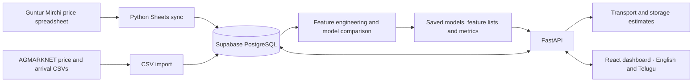

# MirchiMandi

**A price forecasting and selling decision tool for red-chilli farmers in Andhra Pradesh**

MirchiMandi brings market prices, seven-day forecasts, transport estimates, and storage costs into one English and Telugu web app. It helps a farmer compare a village broker's offer with selling at a mandi (agricultural market) or waiting for a later sale.

**Project status:** The repository contains a React frontend, a FastAPI backend, ingestion and training scripts, Andhra Pradesh price reports, and saved model artifacts. A live deployment and field adoption have not been verified.

## Table of Contents

- [Project Overview](#project-overview)
- [Problem Statement](#problem-statement)
- [Proposed Solution](#proposed-solution)
- [Key Features and User Roles](#key-features-and-user-roles)
- [Demonstration Flow](#demonstration-flow)
- [Architecture](#architecture)
- [Technology Stack](#technology-stack)
- [Data and Model Evaluation](#data-and-model-evaluation)
- [Project Structure](#project-structure)
- [Getting Started](#getting-started)
- [Validation and Testing](#validation-and-testing)
- [Deployment Notes](#deployment-notes)
- [Known Limitations and Roadmap](#known-limitations-and-roadmap)

## Project Overview

The project connects agricultural data ingestion and machine learning to a decision a farmer can make after harvest. The pipeline collects variety-level prices, stores them in PostgreSQL, compares forecasting models, and serves prices and estimates through a dashboard. The calculator translates per-quintal quotes into estimated totals for the farmer's actual quantity.

## Problem Statement

A small farmer might harvest around 50 quintals of mirchi from a two-acre plot. A village broker can buy the crop locally, but the offer may be below the price quoted at a larger market such as Guntur. Selling at the mandi adds a transport cost. A nearby cold store gives the farmer more time, but each day of storage adds a charge and the future selling price is uncertain.

A higher mandi quote can still leave the farmer with less money after transport. Similarly, a forecast price increase may be too small to cover storage. The farmer needs a way to compare those costs against the price difference for the whole harvest.

## Proposed Solution

| Decision | What MirchiMandi calculates |
| --- | --- |
| Sell to the local broker | Broker offer per quintal multiplied by the quantity. |
| Transport to the mandi | Estimated mandi proceeds after transport, compared with the broker offer. |
| Store and wait | Estimated change in sale proceeds over the forecast horizon after the app's daily storage charge. |

The broker-versus-mandi calculator and the storage recommendation are separate tools. Together they let the farmer compare the immediate options and assess whether waiting could cover its own cost.

## Key Features and User Roles

| Role | What you can do |
| --- | --- |
| **Farmer or dashboard visitor** | Select a market and variety, view the latest recorded quote and price history, compare markets, inspect a seven-day forecast, and estimate the effect of transport or storage. Switch between English and Telugu. |
| **Community contributor** | Submit a local variety price and upvote reports. Community prices are a separate source from ingested market records. |
| **Administrator** | Use the passcode-protected dashboard to review, verify, or remove submissions and trigger a price sync. |

The price and model views include varieties such as Teja S17, 334 Sannam, Byadgi, 341, DD Deluxe, and Armoor, depending on available data. The dashboard also shows recorded model comparison metrics for supported varieties.

## Demonstration Flow

1. Open the dashboard and select **Guntur APMC** and a variety with price records, such as **Teja S17**.
2. Read the latest quote and its date, then open the history and seven-day forecast.
3. Enter **50 quintals**, a sample broker quote, the origin and destination, and a vehicle type. Compare the estimated mandi proceeds after transport with the broker proceeds.
4. Check the sell-or-wait recommendation for the same quantity. Read the estimated price gain and storage cost behind the recommendation.
5. Explore the community price form or the model comparison view to see how price reports and forecasting results are presented.

## Architecture



The backend reads price records and saved model artifacts, builds forecasts, and applies cost rules. The frontend displays the results and sends calculator inputs and community submissions through the API.

## Technology Stack

| Layer | Technology | Purpose |
| --- | --- | --- |
| Frontend | React, Vite, Tailwind CSS | Bilingual dashboard, forecast views, calculators, and admin screens |
| API and persistence | FastAPI, Uvicorn, psycopg2, Supabase PostgreSQL | Price queries, forecasts, recommendations, and moderation |
| Data processing | Python, Requests, pandas, NumPy | Spreadsheet synchronization, CSV ingestion, and feature engineering |
| Machine learning | scikit-learn, XGBoost, LightGBM, PyTorch, joblib | Regression experiments, model selection, and saved inference artifacts |
| Location lookup | OpenStreetMap Nominatim and a distance fallback | Estimates used by the transport calculator |

## Data and Model Evaluation

- **Data ingestion.** The Sheets scripts import Guntur Mirchi price records. The separate CSV importer can load the AGMARKNET price and arrival reports in [`csv_data/`](csv_data/). A daily sync script is available for scheduling.
- **Features.** The training code uses lagged prices, rolling statistics, price changes, calendar features, and lagged arrival data where available.
- **Comparison.** The trainer defines 12 candidate regressors, including linear baselines, tree ensembles, XGBoost, LightGBM, and a PyTorch MLP. It uses the earliest 80% of observations for training and the final 20% for evaluation. Candidates are ranked by mean absolute error (MAE). The metadata also records RMSE, R², and MAPE.
- **Inference.** FastAPI loads the saved model and feature list for the requested variety. When a trained model is unavailable, the forecast endpoint can use a moving-average fallback if price history is available.

| Variety | Selected model in the saved run | MAE per quintal |
| --- | --- | --- |
| Teja S17 | Lasso Regression | ₹158.41 |
| Red | XGBoost | ₹466.71 |

These are historical holdout results from the [saved Teja S17 metadata](saved_models/meta_Teja_S17.json) and [saved Red metadata](saved_models/meta_Red.json). They are specific to those runs and do not establish seven-day forecast accuracy or gains for farmers.

## Project Structure

```text
backend/                    FastAPI endpoints and Python requirements
frontend/                   React dashboard, Vite config, and npm lockfile
csv_data/                   Andhra Pradesh market price and arrival reports
saved_models/               Model artifacts, feature lists, and evaluation metadata
scripts/                    Sheets sync, CSV import, model training, and daily sync
scratch/check_predictions.py  Local forecast diagnostic
```

## Getting Started

1. Clone the repository and create an isolated Python environment. Install the [backend requirements](backend/requirements.txt). If you plan to rerun ingestion and training, install Requests and PyTorch in that environment as well.
2. Configure a PostgreSQL database you control. The current backend and ingestion and training scripts read a `DB_URL` constant in source. Configure a local working copy with your own connection settings and keep credentials out of Git.
3. From the repository root, run [the CSV importer](scripts/01_upload_to_supabase.py) to initialize and populate the market tables with the included reports. Run [the Sheets sync](scripts/01_sync_google_sheets.py) to add spreadsheet prices if the source is reachable. To retrain, run `python scripts/02_train_models.py` from the root.
4. From `backend/`, start the API with `uvicorn main:app --reload --port 8000`. Open [Swagger UI](http://localhost:8000/docs) to inspect the endpoints. Starting from this directory lets the backend locate `../saved_models`.
5. In a separate terminal, open `frontend/`, run `npm ci`, and start it with `npm run dev`. Set `VITE_API_URL=http://localhost:8000` in `frontend/.env` if you want to configure the endpoint explicitly. Open [the local dashboard](http://localhost:5173).

## Validation and Testing

Reproduce the model comparison with the [training script](scripts/02_train_models.py) and inspect the [saved model metadata](saved_models/). Use the [forecast diagnostic](scratch/check_predictions.py) or the API docs to check price history and inference. For a manual end-to-end check, compare a broker quote with the mandi estimate, then increase the transport cost or change the vehicle to see how the estimated advantage changes. An automated end-to-end suite and a field trial are not documented in this repository.

## Deployment Notes

The intended split is a Vite frontend on Vercel, FastAPI on Render, and PostgreSQL on Supabase. The frontend needs the deployed API URL in `VITE_API_URL`. The backend needs access to its database and saved model artifacts. Move inline database credentials and admin settings to server-side environment variables before publishing a service. The daily sync script requires an external scheduler to run automatically.

## Known Limitations and Roadmap

- Market prices are only as current as the source records and the last successful sync. Check the quote date before using an estimate.
- Transport costs are estimates. The wait recommendation uses a fixed storage assumption of ₹30 per quintal per day. Actual transport quotes, storage fees, and market terms can change the comparison.
- The next steps are to make storage fees configurable, show data freshness more clearly, evaluate forecasts across different dates and markets, and deploy a first pilot for feedback from farmers.
